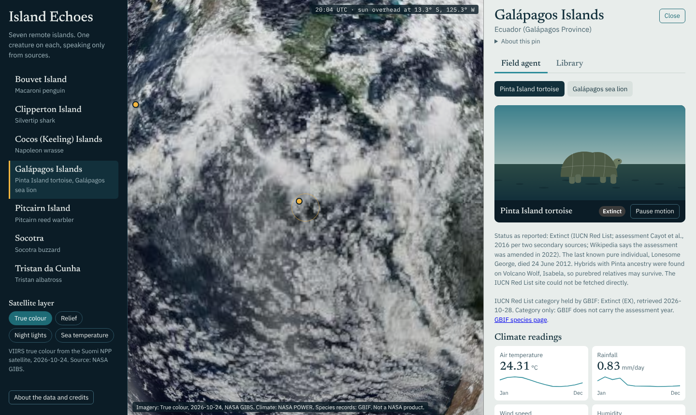
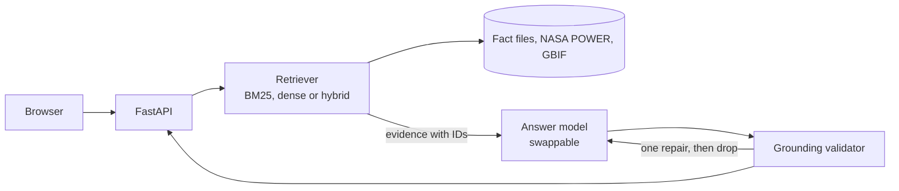

# Island Echoes

A 3D globe of seven remote islands. On each one an endangered or extinct creature reports in as a sensor equipped field agent. Every statement it makes cites a source, and a question the sources cannot answer returns nothing.



Live: <https://island-echoes.onrender.com>

## What it does

- **Globe.** NASA GIBS imagery on a three.js globe (true colour, relief, night lights, sea surface temperature) with a day and night layer computed from the sun's position.
- **Field sites.** Seven islands and eight creatures, listed with official IUCN codes, fact counts and data dates. Each creature has an animated scene and a spoken field report.
- **Climate readings.** NASA POWER 2001 to 2020 monthly means for the grid cell around each island.
- **Library.** 469 sourced facts across twelve categories. Every entry shows its publisher, link, retrieval date and confidence label. Search needs no model and no key.
- **Species records.** GBIF occurrence counts and the IUCN Red List category GBIF holds for each creature.
- **Chat.** Optional. The creature answers in the first person; each factual sentence cites retrieved evidence and passes a mechanical validator before it reaches the screen. Works with a free local model.
- **Operations page.** `/stats.html` shows the data set, retrieval results with intervals, the end to end baselines and live traffic.

| Island | Creature | Category |
|---|---|---|
| Cocos (Keeling) Islands | Napoleon wrasse | Endangered |
| Galápagos Islands | Pinta Island tortoise | Extinct |
| Galápagos Islands | Galápagos sea lion | Endangered |
| Socotra | Socotra buzzard | Vulnerable |
| Tristan da Cunha | Tristan albatross | Critically endangered |
| Pitcairn Island | Pitcairn reed warbler | Endangered |
| Clipperton Island | Silvertip shark | Vulnerable |
| Bouvet Island | Macaroni penguin | Vulnerable |

## Run it

```bash
git clone https://github.com/hudasol/island-echoes && cd island-echoes
python scripts/dev.py run
```

This creates a virtual environment, installs dependencies, copies `.env.example` to `.env` and serves <http://localhost:8000>. The same command works in Windows PowerShell. With Docker: `docker compose up --build`.

Chat is off until `LLM_PROVIDER` is set. Every option runs the same retrieval and the same validator.

```text
LLM_PROVIDER=extractive     # no model: quotes the top sources
LLM_PROVIDER=ollama         # local model: ollama pull qwen2.5:3b-instruct
LLM_PROVIDER=llamacpp       # local GGUF file: LLAMACPP_MODEL_PATH=...
LLM_PROVIDER=huggingface    # free hosted tier: HF_TOKEN=...
LLM_PROVIDER=anthropic      # paid API: ANTHROPIC_API_KEY=...
RETRIEVAL_MODE=hybrid       # bm25 | dense | hybrid (pip install -r requirements-ml.txt)
```

## How it is built



The validator rejects a factual sentence that has no citation, cites evidence that was not retrieved, or contains a number, person or place absent from the cited text. Rejected sentences return to the model once with the reasons; anything still failing is dropped. See [docs/ARCHITECTURE.md](docs/ARCHITECTURE.md).

## Measured results

Frozen 30 question set, one local model (Qwen2.5 3B, 4 bit), hybrid retrieval where used. Each row changes one component.

| System | Passed | False refusals (of 25) | Refusal accuracy (of 5) |
|---|---|---|---|
| Always refuse | 5 of 30 | 25 | 5 |
| Model alone, no sources | 4 of 30 | 15 | 2 |
| Retrieval and model, no validator | 25 of 30 | 0 | 4 |
| Retrieval, model and validator | 19 of 30 | 8 | 5 |

Retrieval on 58 held out paraphrased questions, hit@5 with 95% intervals:

| Ranking | hit@5 |
|---|---|
| Random order | 0.12 |
| Word overlap | 0.72 [0.60, 0.83] |
| BM25 | 0.81 [0.71, 0.91] |
| Hybrid | 0.90 [0.81, 0.97] |

The validator removes unsupported claims and, on a 3B model, declines more answerable questions than the unvalidated system. Details, intervals and paired tests are in [docs/EVALUATION.md](docs/EVALUATION.md) and [docs/RESULTS.md](docs/RESULTS.md).

## Repository

```
app/            FastAPI application: routes, presenters, retrieval, model providers, grounding
data/           fact files, NASA POWER and GBIF snapshots, embeddings
eval/           question sets, baselines, retrieval and end to end evaluation, stored runs
web/            front end, globe bundle source (src/), fonts, service worker
scripts/        task runner, snapshots, data validation, benchmark, statistics
tests/          300 tests; coverage gated at 90 percent
docs/           architecture, API, data, evaluation, results
```

| Task | Command |
|---|---|
| Tests with coverage | `python scripts/dev.py coverage` |
| Lint, types, data, tests | `python scripts/dev.py check` |
| Latency benchmark | `python scripts/dev.py bench` |
| Refresh NASA POWER and GBIF snapshots | `python scripts/dev.py snapshot` |
| Rebuild the results documents | `python scripts/dev.py report` |

CI runs lint, mypy, data validation and tests with coverage, rebuilds the front end bundle and compares it with the committed file, and builds and starts the container.

## Documents

[Architecture](docs/ARCHITECTURE.md) · [API](docs/API.md) · [Data](docs/DATA.md) · [Evaluation](docs/EVALUATION.md) · [Results](docs/RESULTS.md) · [Roadmap](docs/ROADMAP.md) · [Contributing](CONTRIBUTING.md) · [Security](SECURITY.md) · [Changelog](CHANGELOG.md)

## Credits and licence

An independent project, not a NASA product. We acknowledge the use of imagery provided by services from NASA's Global Imagery Browse Services (GIBS), operated by NASA/GSFC/Earth Science Data and Information System (ESDIS). Climate data were obtained from the NASA Langley Research Center (LaRC) POWER Project, funded through the NASA Earth Science/Applied Science Program. Species records come from GBIF.org. [globe.gl](https://github.com/vasturiano/globe.gl) and [three.js](https://threejs.org) (MIT) are bundled into `web/vendor/`; Newsreader and IBM Plex are used under the SIL Open Font License. Code is released under the MIT licence (see `LICENSE`). Fact sources are linked on each fact and keep their own licences.
