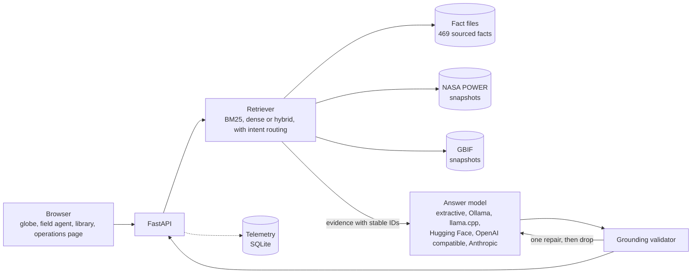

# Architecture

Island Echoes is a FastAPI service that serves a static front end and a small JSON API. Everything the service says about an island is read from three places: the island fact files, NASA POWER climatology and GBIF species records. The language model, when there is one, is a replaceable component that can only rearrange what retrieval hands it.

## Layers

| Layer | Code | Responsibility |
|---|---|---|
| Routes | `app/routes/` | HTTP only: validation, rate limits, response models. One module per concern. |
| Presentation | `app/presenters.py`, `app/schemas.py` | Map domain objects to response models. |
| Data | `app/data/` | Fact store, BM25 retrieval, NASA POWER and GBIF clients with snapshot, cache and live fallback. |
| Retrieval | `app/retrieval/` | Dense embeddings, rank fusion, retriever factory. |
| Models | `app/llm/` | One `AnswerLLM` interface and six providers. |
| Guardrails | `app/chat/grounding.py` | The checks every provider's output passes. |
| Service | `app/chat/service.py` | Retrieve, ask, validate, repair once, assemble the reply. |
| Telemetry | `app/telemetry/` | One SQLite row per request. No question text unless enabled. |

Imports run in one direction: routes depend on the service and data layers, never the reverse. `app/deps.py` carries the objects built in `create_app` (settings, stores, limiters) to the route modules.

## Grounding

1. Retrieval is scoped to the selected island and creature. Each evidence item has a stable ID such as `SOC-011`, `POWER-SOC-TEMP` or `GBIF-GAL-galapagos-sea-lion-OCC`.
2. The model answers through a structured schema: sentences marked `fact` or `voice`, each fact listing the IDs it cites.
3. A fact sentence is rejected when it has no citation, cites an ID that was not retrieved, contains a number that is absent from the cited evidence, or names a person or place that is absent from the cited evidence and the question.
4. Voice sentences carry no information: at most 14 words, no digits, no names.
5. Rejected sentences go back to the model once with the reasons. Anything still failing is dropped. If nothing survives, the reply is a fixed line saying the sources are silent.
6. Questions that share no words with the island's sources are refused without calling the model.

The validator checks words and numbers, not meaning. A sentence built from correct words can still be wrong; the evaluation measures this separately (see [EVALUATION.md](EVALUATION.md)).

## Data flow for climate and species

Each island and creature has a committed snapshot under `data/snapshots/`. A request uses a fresh cache entry, else a fresh snapshot, else a live fetch written to the cache, else a stale copy if the network fails. Snapshots older than `SOURCE_TTL_DAYS` (default 30) count as stale. When live data replaces older data and a value moves, the change is recorded at `/api/data-changes`.

## Front end

`web/` is plain HTML, CSS and JavaScript with no framework. The globe bundle (`web/vendor/globe.bundle.js`) is built from `web/src/` with esbuild and committed, so running the app needs no Node. A service worker caches the shell for offline use.

## Configuration

All settings are environment variables read by `app/config.py`; `.env.example` lists them. API keys are held as `SecretStr` and never appear in logs or `repr`.
